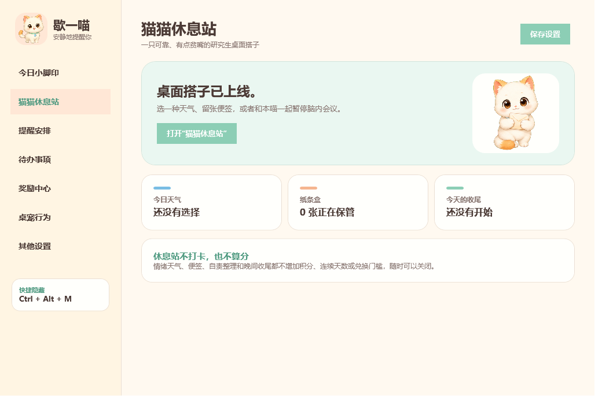
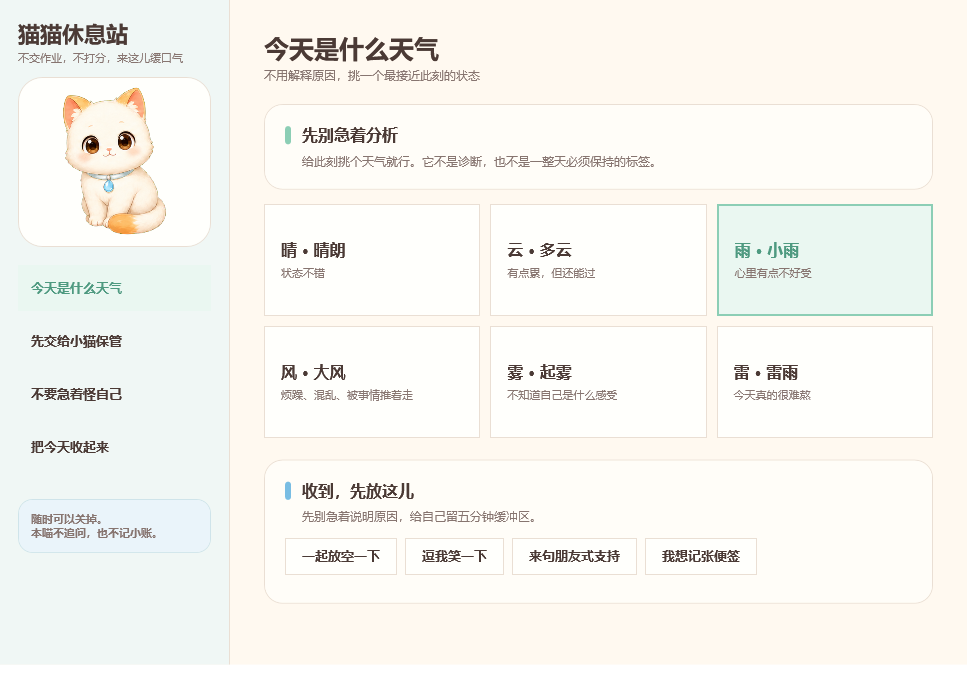
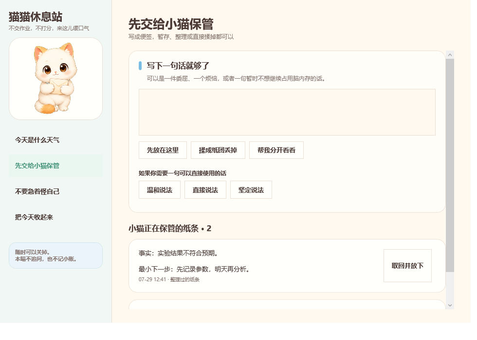
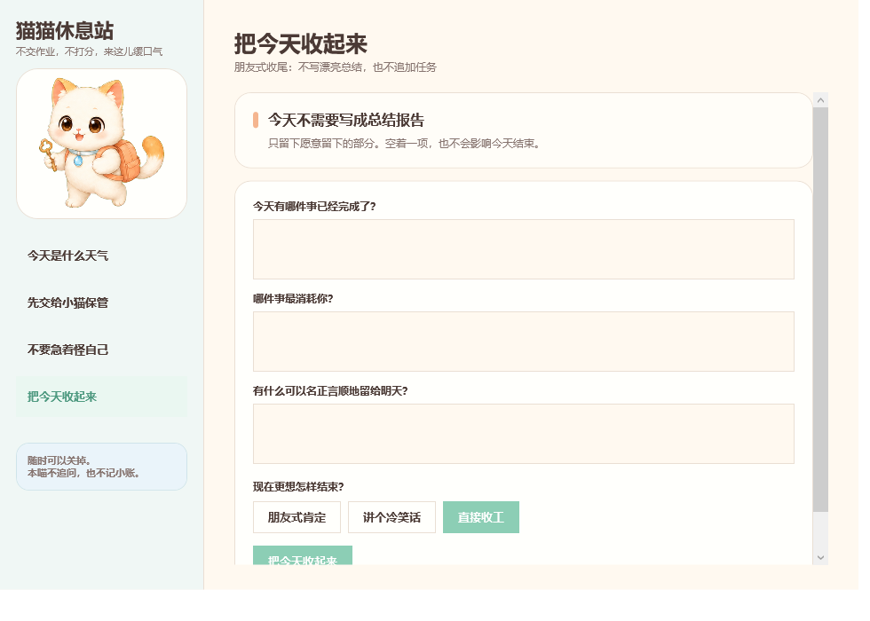
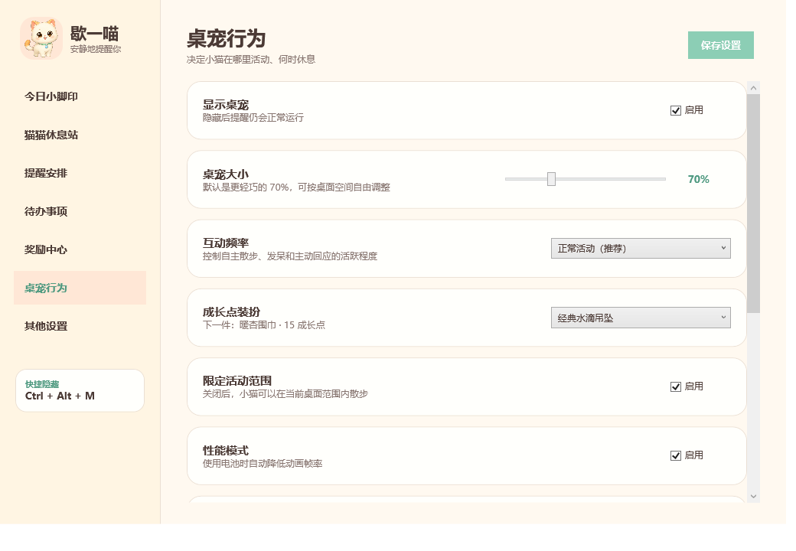

# 歇一喵

一款仅面向 Windows 10/11 的本地健康提醒桌宠：按实际使用电脑的时间提醒喝水、起身活动，也支持吃饭、回宿舍和待办提醒。

它是一只可靠、有点贫嘴的研究生桌面搭子。完全静音、无账号、无网络访问、无遥测，所有设置和便签只保存在本机。

[English](./README_EN.md) · [完整产品说明书](./docs/产品说明书.md) · [版本记录](./CHANGELOG.md) · [下载正式版](../../releases)



## 主要功能

- 喝水和起身活动按实际使用电脑的时间累计；离开电脑后暂停计时，并重置活动计时。
- 自定义吃饭时间，默认每天 00:00 回宿舍提醒。
- 单次、每天、每周、工作日重复待办，支持分类和简单/普通/重要三级难度。
- 完成、10 分钟后、30 分钟后、跳过，以及 50 句随机幽默二次确认。
- 可拖动、摸头、双击互动、连续行走、睡觉、发呆和低频时段气泡。
- 50%–120% 桌宠大小、限定区域或跨扩展屏散步、边缘吸附和位置记忆。
- 全屏、腾讯会议、飞书会议、Zoom、Teams、Webex 自动隐藏，以及手动会议模式。
- 今日小脚印、长期成长点、可消费自由度、80 项默认奖励和自定义奖励。
- 四张免费自我照顾卡、许可条、边界表达、停止反省券和情绪落点。
- “猫猫休息站”：情绪天气、便签盒、自责整理和晚间收尾。
- 可选开机自启动；单文件运行，不需要管理员权限。

## 截图

| 情绪天气 | 便签盒 |
|---|---|
|  |  |

| 晚间收尾 | 桌宠行为设置 |
|---|---|
|  |  |

## 下载与运行

1. 打开仓库右侧的 **Releases**。
2. 下载 `XieYiMiao-v0.7.1-windows.zip`。
3. 解压后双击 `歇一喵.exe`。
4. 首次运行会打开设置，并询问是否随 Windows 自动启动。

程序没有商业代码签名证书。若 Windows 首次运行显示信誉提示，请先核对 Release 中的 SHA256，并使用 Windows Defender 扫描。

## 默认行为

| 项目 | 默认值 |
|---|---|
| 喝水提醒 | 启用，每 45 分钟实际使用时间 |
| 活动提醒 | 启用，每 60 分钟实际使用时间 |
| 离开电脑判断 | 连续 5 分钟没有键盘或鼠标输入 |
| 回宿舍提醒 | 每天 00:00 |
| 桌宠大小 | 70% |
| 互动频率 | 正常活动 |
| 限定活动范围 | 启用 |
| 性能模式 | 启用 |
| 全屏/会议保护 | 启用 |
| 全局显示/隐藏快捷键 | `Ctrl + Alt + M` |

更完整的默认值、算法说明、数据迁移和故障排查见[产品说明书](./docs/产品说明书.md)。

## 本地安全边界

- 不包含网络访问代码、遥测、账号或广告。
- 不播放音频，不使用摄像头、麦克风或定位。
- 不申请管理员权限。
- 设置保存在 `%LocalAppData%\歇一喵\settings.json`。
- 开机启动只写入当前 Windows 用户的启动项。
- 离开识别只使用 Windows 最后输入时间、锁屏和睡眠状态，不做人体识别。

## 从源码构建

要求：Windows 10/11、系统自带的 .NET Framework 4.x 编译器。

```powershell
git clone <YOUR_REPOSITORY_URL>
cd XieYiMiao
powershell.exe -NoProfile -ExecutionPolicy Bypass -File .\build.ps1
```

默认输出：

```text
dist\歇一喵.exe
```

运行自动测试：

```powershell
powershell.exe -NoProfile -ExecutionPolicy Bypass -File .\scripts\test.ps1
```

项目不使用 NuGet 或第三方运行时依赖。构建脚本会把正式 PNG 资源嵌入单个 EXE。

## 仓库结构

```text
XieYiMiao/
├─ src/                    C# / WPF 源码
├─ assets/                 正式猫咪精灵图和走路帧
├─ tools/                  图标生成工具源码
├─ scripts/                测试与 Release 打包脚本
├─ docs/                   产品、架构、隐私与设计文档
├─ .github/                CI、Issue 和 PR 模板
├─ app.manifest            Windows 权限与 Per-Monitor DPI 声明
└─ build.ps1               单文件构建入口
```

## 参与项目

提交问题前请先阅读：

- [贡献指南](./CONTRIBUTING.md)
- [支持与故障反馈](./SUPPORT.md)
- [安全政策](./SECURITY.md)
- [行为准则](./CODE_OF_CONDUCT.md)

错误报告请附上 Windows 版本、显示器数量与缩放、复现步骤、期望结果和实际结果。请勿上传 `%LocalAppData%\歇一喵\settings.json`，其中可能包含私人待办或便签。

## 许可证

当前仓库采用“源码可见、保留全部权利”的许可方式，并非 OSI 认可的开源许可证。允许查看、学习和为本项目贡献，但未经书面许可不得再发布、商用、制作衍生产品或单独使用角色素材。详见 [LICENSE](./LICENSE)。

## 当前版本

`v0.7.1` — 纯友谊向桌面搭子。完整变化见 [CHANGELOG.md](./CHANGELOG.md) 和 [RELEASE_NOTES.md](./RELEASE_NOTES.md)。
