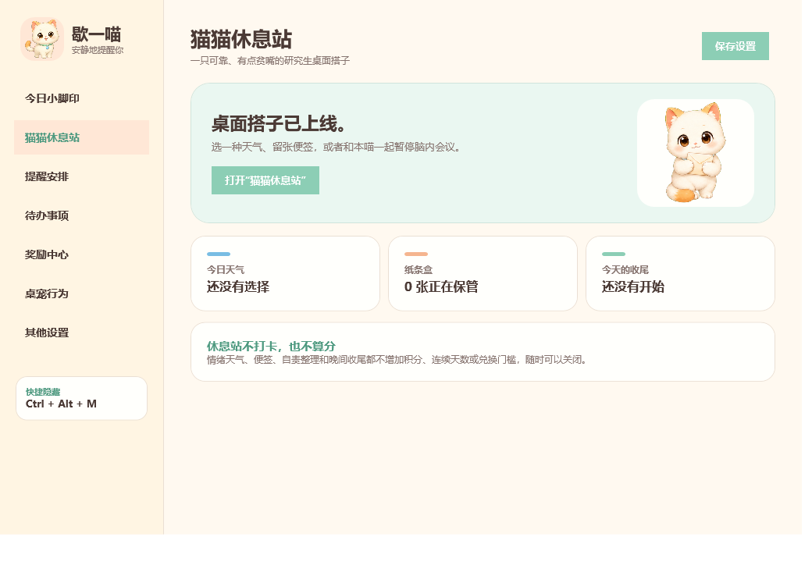

# XieYiMiao

XieYiMiao is a local-only Windows desktop cat that reminds you to drink water,
move around, eat, return to your dorm, and complete personal to-dos. Water and
movement timers count active computer use rather than wall-clock time.

The app is silent, account-free, telemetry-free, and network-free. Settings,
notes, and reward history remain on the local computer.

[中文说明](./README.md) · [Changelog](./CHANGELOG.md) · [Release notes](./RELEASE_NOTES.md)



## Highlights

- Active-use water and movement timers with idle/lock detection.
- Configurable meal, dorm, and recurring to-do reminders.
- Multi-monitor movement, per-monitor DPI support, edge snapping, and safe
  recovery after monitors are disconnected.
- Full-screen and meeting protection for Tencent Meeting, Feishu/Lark, Zoom,
  Microsoft Teams, and Webex.
- Animated pet interactions, three activity levels, adjustable size, and
  growth-point outfits.
- Local progress, spendable freedom points, 80 built-in rewards, and custom
  rewards.
- A friendship-oriented rest station with emotion weather, a private note box,
  self-criticism reframing, and an evening shutdown ritual.
- A single Windows executable with no NuGet or third-party runtime dependency.

## Run

Download the Windows archive from **Releases**, extract it, and run
`歇一喵.exe`. Windows 10 or Windows 11 is required. Administrator privileges
are not required.

The executable is not commercially code-signed. Verify the SHA256 file in the
release and scan the download with Windows Defender if Windows shows a first-run
reputation warning.

## Build

```powershell
powershell.exe -NoProfile -ExecutionPolicy Bypass -File .\build.ps1
powershell.exe -NoProfile -ExecutionPolicy Bypass -File .\scripts\test.ps1
```

The build output is written to `dist/`.

## Privacy and security

- No network access, analytics, accounts, ads, audio playback, camera, or
  microphone access.
- Local data is stored in `%LocalAppData%\歇一喵`.
- Idle detection uses Windows last-input, lock, sleep, and resume state only.
- Startup registration is written for the current Windows user only.

## License

This repository is source-available and all rights are reserved. It is not
currently distributed under an OSI-approved open-source license. See
[LICENSE](./LICENSE).
