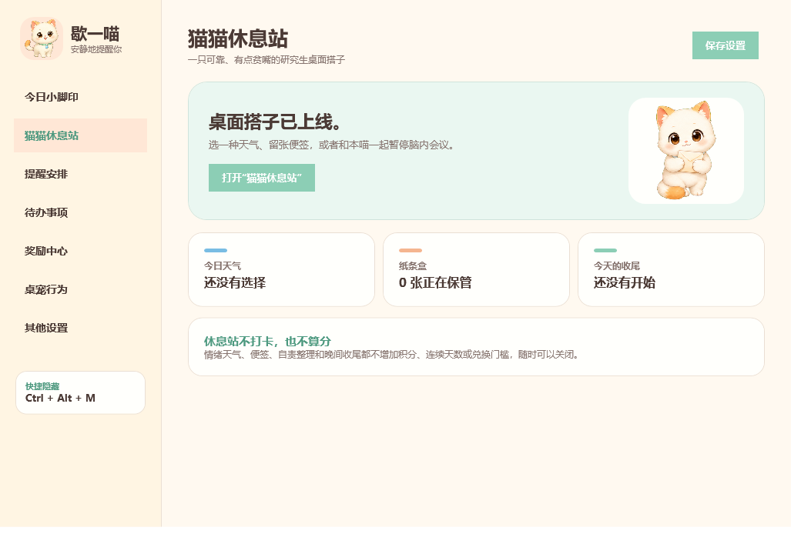
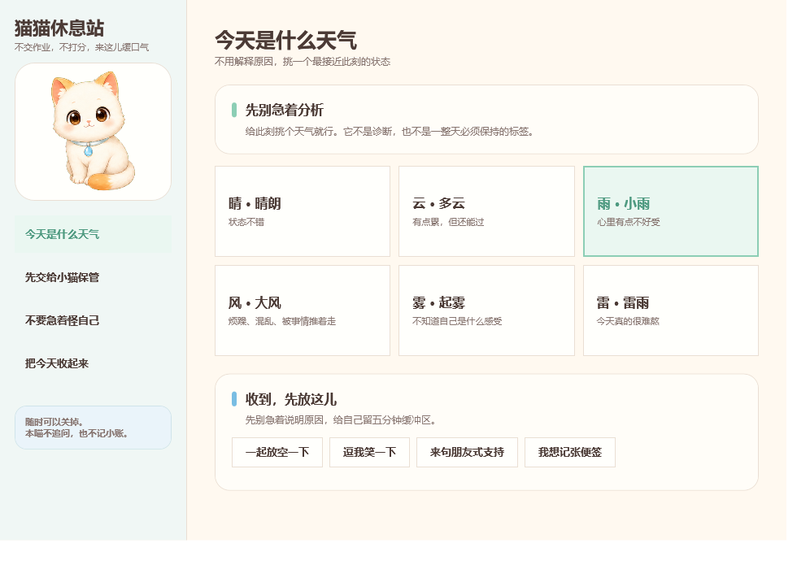
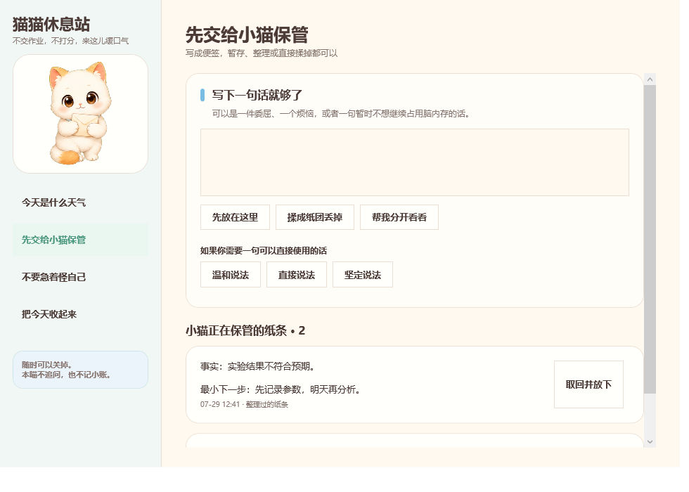
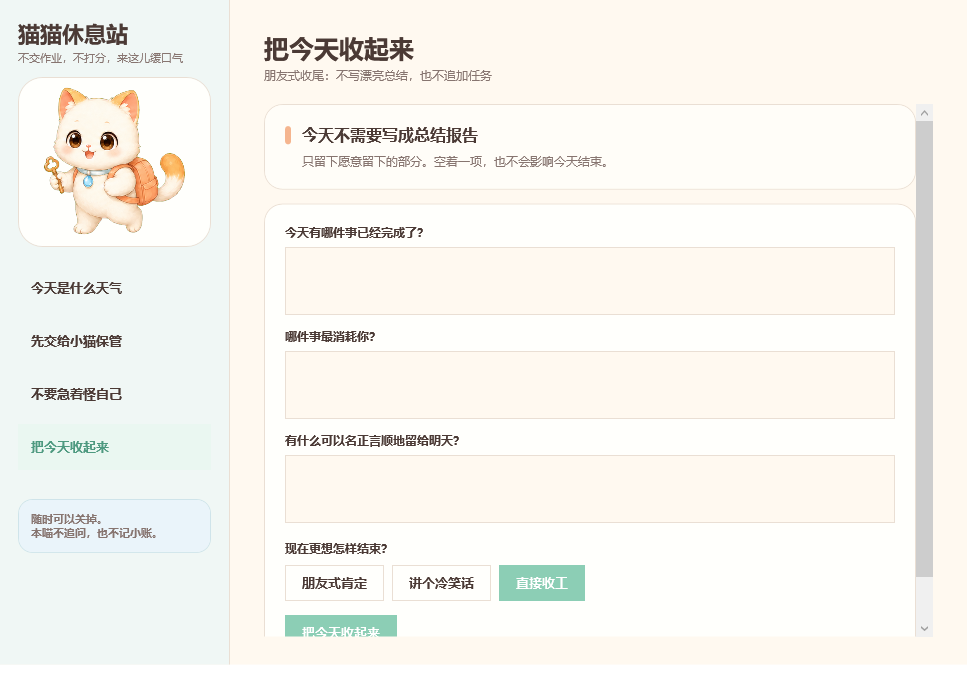
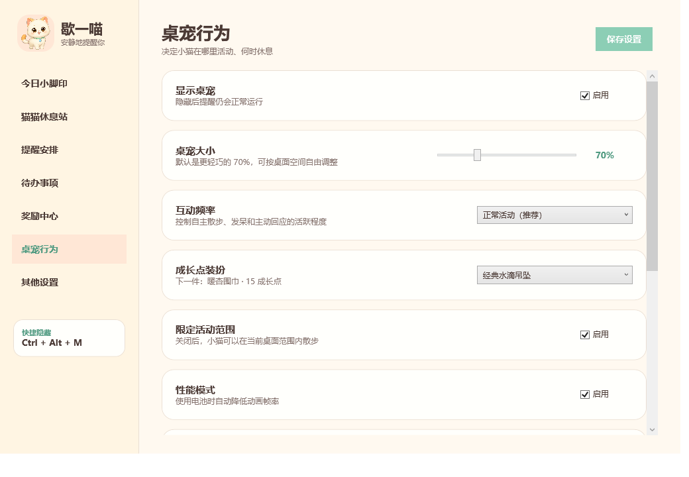

# 歇一喵 0.7.1 产品说明书

> Windows 本地健康提醒桌宠<br>
> 产品定位：一只可靠、有点贫嘴的研究生桌面搭子<br>
> 文件版本：0.7.1.0<br>
> 适用系统：Windows 10 / Windows 11
> 本说明书面向最终使用者，也可用于软件交付、验收、备份和故障排查。

---

## 目录

1. [产品简介](#1-产品简介)
2. [运行环境与交付文件](#2-运行环境与交付文件)
3. [三分钟快速开始](#3-三分钟快速开始)
4. [首次运行、后台运行与退出](#4-首次运行后台运行与退出)
5. [主设置窗口](#5-主设置窗口)
6. [健康提醒系统](#6-健康提醒系统)
7. [待办事项](#7-待办事项)
8. [桌面宠物](#8-桌面宠物)
9. [猫猫休息站](#9-猫猫休息站)
10. [今日小脚印、成长点与自由度](#10-今日小脚印成长点与自由度)
11. [奖励中心](#11-奖励中心)
12. [每日四张自我照顾卡](#12-每日四张自我照顾卡)
13. [全屏、会议与离开电脑识别](#13-全屏会议与离开电脑识别)
14. [快捷键与任务栏托盘](#14-快捷键与任务栏托盘)
15. [多显示器、位置记忆与窗口找回](#15-多显示器位置记忆与窗口找回)
16. [开机自动启动](#16-开机自动启动)
17. [本地数据、备份、迁移与卸载](#17-本地数据备份迁移与卸载)
18. [默认设置速查表](#18-默认设置速查表)
19. [默认奖励库清单](#19-默认奖励库清单)
20. [安全边界与能力限制](#20-安全边界与能力限制)
21. [常见问题与故障排查](#21-常见问题与故障排查)
22. [交付验收信息](#22-交付验收信息)
23. [快捷操作速查](#23-快捷操作速查)

---

## 1. 产品简介

### 1.1 歇一喵是什么

歇一喵是一款完全在 Windows 本机运行的健康提醒桌宠。它在桌面角落以小猫形象活动，并按照实际使用电脑的时间提醒使用者：

- 喝水；
- 起身活动；
- 吃饭；
- 回宿舍；
- 完成用户自己设置的待办事项。

除了提醒功能，歇一喵还包含：

- 可拖动、散步、发呆、睡觉和互动的桌面小猫；
- 单屏与扩展屏安全移动；
- 全屏和会议自动隐藏；
- 今日行为记录；
- 成长点、自由度和奖励兑换；
- 待办分类、难度与重复规则；
- 免费自我照顾卡和边界表达工具；
- 情绪天气、便签盒、自责整理和晚间收尾。

### 1.2 产品气质

歇一喵不是监督软件，也不扮演亲密关系。它的定位是：

> 一只熟悉、可靠、有点贫嘴的研究生桌面搭子。

它可以提醒、听吐槽、讲冷笑话、帮忙整理思路，但不会使用专属、排他、依赖或情感承诺式表达。

### 1.3 核心设计原则

- **安静**：没有提示音、背景音乐或语音。
- **本地**：没有账号、云端同步、网络上传或遥测。
- **可退出**：桌宠、提醒、暖心补充语、会议保护和开机启动均可调整。
- **不惩罚**：没有断签、欠账、连续天数惩罚或积分上限。
- **尊重实际状态**：离开电脑时不继续累计喝水和活动用时。
- **朋友式提醒**：说明事件，不使用羞辱或强迫性语言。

---

## 2. 运行环境与交付文件

### 2.1 系统要求

| 项目 | 要求 |
|---|---|
| 操作系统 | Windows 10 或 Windows 11 |
| 运行权限 | 普通用户权限，不需要管理员权限 |
| 安装程序 | 不需要 |
| 网络连接 | 不需要 |
| 声音设备 | 不需要，程序完全静音 |
| 摄像头或麦克风 | 不需要，也不会调用 |
| 外部素材 | 不需要，猫咪图片和动画已经嵌入 EXE |
| 第三方运行库 | 不需要单独安装 |

### 2.2 最少交付方式

只发送下面这个文件，程序即可运行：

```text
歇一喵.exe
```

### 2.3 推荐交付方式

建议把整个 `歇一喵-0.7.1` 文件夹发送给使用者。文件夹中包含：

| 文件 | 用途 |
|---|---|
| `歇一喵.exe` | 主程序，双击运行 |
| `歇一喵-0.7.1-产品说明书.md` | 本完整说明书 |
| `使用说明.md` | 精简版快速说明 |
| `测试报告.txt` | 自动测试、界面测试和安全检查结果 |
| `自动测试明细.txt` | 134 项自动测试明细 |
| `SHA256.txt` | EXE 和源代码包的校验值 |
| `歇一喵-0.7.1-源代码.zip` | 可审阅、可重建的源代码 |
| `猫猫休息站-*.png` | 猫猫休息站实际界面预览 |
| `设置页-*.png` | 设置界面实际预览 |

### 2.4 文件校验

收到程序后，可以使用 PowerShell 校验：

```powershell
Get-FileHash .\歇一喵.exe -Algorithm SHA256
```

0.7.1 正式版 EXE 的正确 SHA256 为：

```text
85C689DF2BD015D64DB3A13919B319BB5735C326B5E8BE10F62BCAF6CB8051BE
```

如果校验值不一致，不建议继续运行，应重新从交付者处获取文件。

---

## 3. 三分钟快速开始

### 第一步：启动程序

双击 `歇一喵.exe`。

首次启动时：

1. 程序会打开设置窗口；
2. 询问是否随 Windows 自动启动；
3. 无论选择“是”还是“否”，之后都可以在设置中修改。

### 第二步：确认桌宠出现

默认情况下，小猫会出现在当前显示器的右下角。

如果暂时没有看到：

1. 按 `Ctrl + Alt + M`；
2. 或在任务栏右下角找到歇一喵托盘图标；
3. 右键托盘图标，选择“显示桌宠”；
4. 仍然找不到时，打开设置 → 桌宠行为 → “找回所有窗口”。

### 第三步：设置提醒

打开“设置 → 提醒安排”：

- 喝水默认每实际使用电脑 45 分钟提醒一次；
- 起身活动默认每实际使用电脑 60 分钟提醒一次；
- 吃饭时间由使用者自行添加；
- 回宿舍默认每天 00:00 提醒。

### 第四步：添加待办

打开“设置 → 待办事项 → 新增待办”，填写：

- 标题；
- 备注；
- 日期和时间；
- 是否重复；
- 分类；
- 难度。

### 第五步：保存设置

点击右上角“保存设置”。部分桌宠设置会即时生效，但仍建议保存一次。

---

## 4. 首次运行、后台运行与退出

### 4.1 首次运行

首次运行会显示设置窗口，并询问开机启动。选择不会影响其他功能。

### 4.2 第二次及之后运行

正常双击 EXE 时会打开设置窗口。桌宠和提醒引擎会继续在后台运行。

### 4.3 单实例运行

歇一喵只允许同时运行一个实例。如果重复双击，会显示：

```text
歇一喵已经在运行了，可以从任务栏托盘打开设置。
```

### 4.4 点击窗口右上角“×”会发生什么

- 关闭设置窗口：窗口隐藏，程序继续运行；
- 关闭猫猫休息站：窗口隐藏，程序继续运行；
- 提醒、待办和桌宠不会因为关闭设置窗口而停止。

### 4.5 正确退出程序

可以通过以下任一方式真正退出：

- 右键桌宠 → “退出歇一喵”；
- 右键任务栏托盘图标 → “退出歇一喵”。

退出前程序会保存当前设置和数据。

---

## 5. 主设置窗口

设置窗口左侧共有七个主要入口：

| 页面 | 主要用途 |
|---|---|
| 今日小脚印 | 查看当天完成次数、成长点和自由度 |
| 猫猫休息站 | 打开情绪天气、便签盒、自责整理和晚间收尾 |
| 提醒安排 | 设置喝水、活动、吃饭和回宿舍 |
| 待办事项 | 添加、编辑、分类和完成待办 |
| 奖励中心 | 完成照顾卡、查看积分、兑换或自定义奖励 |
| 桌宠行为 | 调整大小、活动范围、互动频率、装扮和保护模式 |
| 其他设置 | 开机启动、提醒补充语、快捷键、离开阈值和数据目录 |

### 5.1 今日小脚印

今日小脚印会分别统计当天完成的：

- 喝水；
- 活动；
- 吃饭；
- 回宿舍；
- 待办。

首页还显示：

- 长期成长点；
- 当前可用自由度；
- 今日获得自由度；
- 新增待办、添加吃饭时间和猫猫休息站快捷入口。

### 5.2 停止反省券

在奖励中心可以使用“停止反省券”。启用后：

- 今日小脚印、成长点和未完成统计在首页暂时隐藏；
- 已经获得的成长点和自由度不会丢失；
- 第二天自动恢复；
- 不会产生断签或欠账。

---

## 6. 健康提醒系统

### 6.1 提醒类型

歇一喵支持五类提醒：

1. 喝水；
2. 起身活动；
3. 吃饭；
4. 回宿舍；
5. 待办事项。

### 6.2 喝水提醒

- 默认启用；
- 默认间隔：45 分钟；
- 可设置范围：5–240 分钟；
- 只累计实际使用电脑的时间；
- 完成一次获得 1 点成长点和 1 点自由度。

点击“完成”后，喝水计时从 0 重新开始。

点击“跳过”后，本轮不加分，喝水计时也从 0 重新开始。

点击“10分钟后”或“30分钟后”后，当前累计时长会保留，延后时间到达后再次提醒。

### 6.3 起身活动提醒

- 默认启用；
- 默认间隔：60 分钟；
- 可设置范围：5–240 分钟；
- 只累计实际使用电脑的时间；
- 完成一次获得 2 点成长点和 2 点自由度。

当程序判断使用者已经离开电脑达到设定阈值时，会认为本轮已经自然活动过，并重置活动计时。

注意：离开电脑只重置活动计时，不会重置喝水计时。

### 6.4 吃饭提醒

程序不预设统一吃饭时间，由使用者自行添加。

每个吃饭提醒可以设置：

- 名称，例如早餐、午饭、晚饭、夜宵；
- 24 小时时间，例如 `12:30`；
- 周一至周日中的任意重复日；
- 是否启用。

规则：

- 至少选择一天；
- 同一条吃饭提醒每天最多触发一次；
- 到点后 2 小时内有效；
- 超过 2 小时且没有触发时，本次自动过期；
- 完成一次获得 2 点成长点和 2 点自由度。

### 6.5 回宿舍提醒

- 默认启用；
- 默认时间：每天 00:00；
- 可以自行修改时间；
- 到点后 2 小时内有效；
- 完成一次获得 2 点成长点和 2 点自由度；
- 对应的小猫形态会背上研究生小书包。

### 6.6 提醒卡片

提醒出现时，卡片会尽量显示在桌宠附近，并自动保持在当前显示器可见范围内。

卡片提供四个按钮：

| 按钮 | 结果 |
|---|---|
| 完成 | 记录完成、增加小脚印和对应积分 |
| 10分钟后 | 10 分钟后重新提醒 |
| 30分钟后 | 30 分钟后重新提醒 |
| 跳过 | 本轮结束，不增加积分 |

### 6.7 幽默二次确认

点击“完成”“10分钟后”“30分钟后”或“跳过”后，会再出现一次确认窗口。

程序内置 50 句随机确认文案：

- 完成类 20 句；
- 延后类 15 句；
- 跳过类 15 句；
- 同一类文案避免连续重复。

取消二次确认后，原提醒卡会重新出现，不会执行刚才的操作。

### 6.8 提醒卡自动收起

如果提醒卡持续 30 秒没有操作：

- 卡片会自动隐藏；
- 桌宠会显示提醒角标；
- 点击带角标的桌宠，可以重新打开当前提醒。

如果桌宠本身被隐藏，可先使用快捷键或托盘重新显示桌宠。

### 6.9 提醒优先级

当多个提醒同时到期时，程序一次只显示一个，顺序为：

1. 已经延后的提醒；
2. 到期待办；
3. 吃饭提醒；
4. 回宿舍提醒；
5. 喝水和活动提醒。

### 6.10 暂停全部提醒

右键任务栏托盘图标，选择“暂停提醒 1 小时”，可暂时停止所有新提醒。

暂停期间：

- 已经设置的提醒不会被删除；
- 到期提醒会等待暂停结束；
- 桌宠仍可显示和互动。

### 6.11 暖心补充语

“设置 → 其他设置 → 显示暖心补充语”默认启用。

关闭后：

- 提醒标题仍然正常显示；
- 只隐藏标题下面的补充句；
- 不影响提醒时间和积分。

---

## 7. 待办事项

### 7.1 新增待办

进入“设置 → 待办事项 → 新增待办”。

可填写：

| 字段 | 说明 |
|---|---|
| 待办事项 | 必填标题 |
| 备注 | 可选，到点时作为提醒补充内容 |
| 日期 | 到期日期 |
| 时间 | 24 小时制，例如 `18:30` |
| 重复 | 不重复、每天、每周、工作日 |
| 分类 | 选择已有分类 |
| 难度 | 简单、普通、重要 |

新增待办默认：

- 到期时间为当前时间约 1 小时后；
- 不重复；
- 未分类；
- 普通难度。

### 7.2 重复规则

| 类型 | 完成后的处理 |
|---|---|
| 不重复 | 标记完成，不再提醒 |
| 每天 | 自动移动到下一天同一时间 |
| 每周 | 自动移动到下一周同一时间 |
| 工作日 | 自动移动到下一个周一至周五 |

如果重复待办已经错过多个周期，完成后会自动跳到未来最近的有效日期。

### 7.3 待办难度与积分

| 难度 | 完成奖励 |
|---|---:|
| 简单 | 1 点 |
| 普通 | 3 点 |
| 重要 | 5 点 |

获得的点数会同时加入成长点和自由度，不设每日上限。

### 7.4 默认分类

程序预置：

- 科研；
- 学习；
- 工作；
- 生活；
- 健康；
- 其他；
- 未分类。

### 7.5 分类管理

在待办页点击“管理分类”，可以：

- 新建分类；
- 重命名分类；
- 修改分类颜色；
- 删除自定义或普通分类。

“未分类”是兜底分类，不能删除。

删除一个仍然包含待办的分类时，这些待办会自动转入“未分类”，不会丢失。

### 7.6 过期待办

过期的待办不会像吃饭或回宿舍提醒一样自动失效。它会继续保持到期状态，直到使用者：

- 完成；
- 延后；
- 跳过；
- 编辑或删除。

### 7.7 待办提醒操作

- 完成：增加对应难度积分；
- 延后：10 或 30 分钟后再次提醒；
- 跳过：本轮结束；不重复待办会结束，重复待办会进入下一周期；
- 任何操作都需要幽默二次确认。

---

## 8. 桌面宠物

### 8.1 基础形象

桌宠是一只奶油白幼猫，具有：

- 杏色耳尖和尾尖；
- 暖棕色眼睛；
- 薄荷绿项圈；
- 浅蓝色水滴吊坠。

### 8.2 动画与形态

程序包含 16 类主要状态，并使用 8 帧连续走路动画。常见形态包括：

- 正常待机；
- 走路；
- 喝水提醒；
- 起身活动提醒；
- 吃饭提醒；
- 待办提醒；
- 开心；
- 猫饼；
- 熟睡；
- 长伸懒腰；
- 被拖动时四脚悬空；
- 抱便签；
- 背包回宿舍；
- 安静待机；
- 摸头反应；
- 其他提醒和过渡状态。

### 8.3 鼠标互动

| 操作 | 小猫反应 |
|---|---|
| 单击头部 | 眯眼、蹭手式摸头反应 |
| 单击身体 | 开心回应 |
| 双击 | 随机伸懒腰、猫饼、发呆或开心 |
| 鼠标靠近 | 正常或活泼模式下产生短暂回应 |
| 按住拖动 | 变为四脚悬空形态 |
| 松开拖动 | 吸附最近屏幕边缘并伸懒腰 |
| 右键 | 打开桌宠菜单 |

如果当前存在收起的提醒，单击桌宠会优先重新显示提醒卡。

### 8.4 右键菜单

右键桌宠可使用：

- 显示或隐藏桌宠；
- 打开猫猫休息站；
- 打开设置；
- 退出歇一喵。

### 8.5 桌宠大小

打开“设置 → 桌宠行为 → 桌宠大小”。

- 范围：50%–120%；
- 步进：10%；
- 默认：70%；
- 调整后立即生效并自动保存；
- 调整尺寸时会尽量保持当前吸附边缘不变。

### 8.6 互动频率

| 档位 | 行为特点 |
|---|---|
| 安静待机 | 更少散步和主动动作，不主动显示文字气泡 |
| 正常活动（推荐） | 在安静和活跃之间保持平衡 |
| 活泼捣乱 | 更频繁散步、发呆、回应鼠标和显示气泡 |

参考频率：

| 档位 | 自主散步间隔 | 发呆动作间隔 | 主动气泡 |
|---|---:|---:|---:|
| 安静待机 | 约 28–49 秒 | 约 30–54 秒 | 不主动显示 |
| 正常活动 | 约 11–22 秒 | 约 15–29 秒 | 约 25–45 分钟 |
| 活泼捣乱 | 约 6–12 秒 | 约 8–16 秒 | 约 12–23 分钟 |

间隔会随机变化，避免动作完全机械。

### 8.7 时段行为

- 白天会在猫饼、伸懒腰、发呆等姿态间切换；
- 23:00 至次日 07:00 更容易熟睡或背上书包；
- 时段气泡会根据早晨、白天、饭点、傍晚和深夜选择不同内容；
- 气泡不会覆盖提醒卡，也不会在安静待机、会议或全屏保护期间出现。

### 8.8 限定活动范围

默认启用。

启用时：

- 小猫以最近拖放位置为活动中心；
- 主要在约左右各 220 像素、上下各 40 像素的范围内散步；
- 适合让小猫长期待在桌面某个角落。

关闭时：

- 小猫可以在整个虚拟桌面范围内散步；
- 有扩展屏时可以跨屏移动；
- 程序会避开显示器之间不存在的虚拟空隙。

### 8.9 性能模式

默认启用。

- 接通电源时保持正常动画频率，约 33 毫秒一帧；
- 使用电池时自动降低到约 80 毫秒一帧；
- 只调整动画刷新率，不影响提醒准确性。

---

## 9. 猫猫休息站

猫猫休息站是独立窗口，可以从以下位置打开：

- 桌宠右键菜单；
- 设置左侧“猫猫休息站”；
- 设置首页快捷按钮；
- 任务栏托盘菜单。



### 9.1 今天是什么天气

可以从六种“情绪天气”中选择当前最接近的状态：

- 晴朗；
- 多云；
- 小雨；
- 大风；
- 起雾；
- 雷雨。

选择后可以继续：

- 一起放空一下；
- 逗我笑一下；
- 来句朋友式支持；
- 记一张便签。

情绪天气：

- 不是诊断；
- 不产生积分；
- 不形成趋势或连续签到；
- 每天自然重置；
- 只保存在本机。



### 9.2 先交给小猫保管

可以写下一句话，然后选择：

- 先放在这里；
- 揉成纸团丢掉；
- 帮我分开看看；
- 生成温和、直接或坚定的边界表达。

保存的便签会显示创建时间，并保存在本机设置文件中。

揉成纸团的内容不会保存。

保存后的便签可以“取回并放下”，即从便签盒删除。



### 9.3 不要急着怪自己

页面通过五个问题帮助把不同内容分开：

1. 我现在正在怎样批评自己；
2. 已经发生、可以确认的事实是什么；
3. 如果是朋友遇到这件事，我会怎样对他说；
4. 现在最小、最实际的一步是什么；
5. 如果今天不处理，会有什么真实后果。

程序只根据填写内容整理纸条：

- 不自动分析心理状态；
- 不判断谁对谁错；
- 不假装理解未填写的信息；
- 不替代专业心理或医疗帮助。

整理结果可以复制、清空或放进便签盒。

### 9.4 把今天收起来

晚间收尾可记录：

- 今天已经完成的事；
- 最消耗自己的事；
- 可以留给明天的事。

收尾方式可以选择：

- 朋友式肯定；
- 讲个冷笑话；
- 直接收工。

同一天完成后仍可重新编辑。

晚间收尾：

- 默认启用；
- 不额外弹窗催促；
- 不增加积分；
- 不影响四张照顾卡；
- 不产生断签。



### 9.5 全屏和会议期间

进入全屏或会议保护时：

- 猫猫休息站会自动隐藏；
- 桌宠会自动隐藏；
- 提醒卡和二次确认窗口会隐藏或关闭；
- 保护结束后不会立即弹出提醒，会先进入缓冲期。

---

## 10. 今日小脚印、成长点与自由度

### 10.1 今日小脚印

小脚印代表当天完成的提醒次数：

- 喝水次数；
- 活动次数；
- 吃饭次数；
- 回宿舍次数；
- 待办次数。

小脚印每天自动归零，不影响长期成长点和自由度。

### 10.2 成长点

成长点用于记录长期累计行为：

- 只增加；
- 不因兑换奖励而扣除；
- 不按天归零；
- 用于解锁桌宠装扮。

### 10.3 自由度

自由度是可消费积分：

- 完成提醒时与成长点同时增加；
- 兑换普通奖励时扣除；
- 不按天归零；
- 没有每日获取上限。

### 10.4 积分规则

| 行为 | 成长点 | 自由度 |
|---|---:|---:|
| 完成喝水 | +1 | +1 |
| 完成起身活动 | +2 | +2 |
| 完成吃饭 | +2 | +2 |
| 完成回宿舍 | +2 | +2 |
| 完成简单待办 | +1 | +1 |
| 完成普通待办 | +3 | +3 |
| 完成重要待办 | +5 | +5 |
| 当天五类行为都至少完成一次 | 额外 +3 | 额外 +3 |

“五类行为”指：

1. 喝水；
2. 活动；
3. 吃饭；
4. 回宿舍；
5. 任意待办。

平衡奖励每天最多触发一次，普通行为积分没有每日上限。

### 10.5 装扮解锁

| 成长点 | 装扮 |
|---:|---|
| 0 | 经典水滴吊坠 |
| 15 | 暖杏围巾 |
| 35 | 小小睡帽 |
| 60 | 研究生小书包 |
| 100 | 护目镜与小扳手 |

装扮只按成长点解锁，不消耗成长点或自由度。

---

## 11. 奖励中心

### 11.1 奖励中心结构

奖励中心按照固定顺序显示：

1. 每日四张自我照顾卡；
2. “今天先考虑自己”免费区；
3. “舒服一点”免费区；
4. 小猫许可条、边界表达和停止反省券；
5. 情绪落点；
6. 需要自由度的奖励。

### 11.2 免费奖励

“今天先考虑自己”和“舒服一点”共有 20 项默认奖励：

- 自由度消耗为 0；
- 不需要先完成四张照顾卡；
- 可以不限次数使用；
- 不设置休息时长；
- 使用记录会保存在兑换历史中，但不扣积分。

### 11.3 普通奖励兑换条件

兑换需要自由度的奖励前，必须：

1. 完成当天身体、感受、边界和善意四张照顾卡；
2. 拥有足够自由度；
3. 在确认窗口中确认兑换。

### 11.4 随机奖励

点击“随机一个可兑换奖励”后：

- 只从当前自由度足够的普通奖励中抽取；
- 必须先完成四张照顾卡；
- 抽中后仍会询问是否兑换；
- 不会自动扣除自由度。

### 11.5 收藏、编辑与删除

每个奖励可以：

- 收藏或取消收藏；
- 兑换；
- 编辑；
- 删除。

收藏奖励会在同一类别中优先显示。

### 11.6 自定义奖励

点击“新增奖励”，可设置：

- 奖励名称；
- 说明；
- 类型；
- 需要自由度；
- 可选时长；
- 是否允许重复兑换。

普通奖励自由度至少为 1。

“今天先考虑自己”和“舒服一点”类型会自动变为免费。

“休息”类型无论输入什么时长，都会自动取消时长限制。

### 11.7 可选静音倒计时

带时长的奖励兑换成功后，可以选择打开静音倒计时。

- 不播放声音；
- 不强制使用；
- 娱乐类、社交类等可以设置时长；
- 休息类、免费自我照顾类不设置时长。

### 11.8 涉及朋友的奖励

部分奖励例如“给朋友们点一次外卖”会额外显示一条提醒：

- 也给自己留一份；
- 程序不记录实际花费；
- 不要求现在回答。

---

## 12. 每日四张自我照顾卡

每天有四张卡：

| 卡片 | 核心内容 |
|---|---|
| 身体 | 今天认真吃过、喝过或让身体休息过 |
| 感受 | 承认当前感受，不急着否定 |
| 边界 | 至少一次没有立刻牺牲自己满足别人 |
| 善意 | 把对朋友会说的话也送给自己一次 |

规则：

- 每张每天完成一次；
- 四张全部完成后，普通奖励兑换解锁；
- 没有连续天数；
- 没有断签；
- 没有欠账；
- 没有失败提示；
- 第二天自然重置；
- 不会扣除成长点或自由度。

---

## 13. 全屏、会议与离开电脑识别

### 13.1 离开电脑如何判断

歇一喵不使用摄像头、麦克风或人体识别。

它只读取 Windows 提供的：

- 最后一次键盘输入时间；
- 最后一次鼠标输入时间；
- 会话是否锁定；
- 电脑是否进入睡眠或恢复。

默认连续 5 分钟没有键盘或鼠标输入，视为离开电脑。

可在“设置 → 其他设置 → 判断离开电脑”修改，允许范围为 2–60 分钟。

### 13.2 离开电脑后的行为

离开后：

- 喝水计时暂停；
- 活动计时暂停并重置为 0；
- 不弹出新的提醒；
- 锁屏或电脑睡眠同样视为离开。

回到电脑后：

- 先等待约 2 分钟；
- 然后恢复提醒；
- 避免刚坐下就立刻被弹窗打断。

### 13.3 会议观看如何计时

如果会议保护已经生效，但电脑没有锁屏，并且空闲时间少于 30 分钟，程序仍会把这段时间视为实际使用电脑。

这样可以避免“只听会议、没有动鼠标”时完全不累计喝水和活动时间。

### 13.4 自动会议保护

默认启用。当前台窗口属于以下程序或具有相应会议标题时，会自动保护：

- 腾讯会议：`wemeet`、`tencentmeeting`；
- 飞书或 Lark：`lark`、`feishu`；
- Zoom：`zoom`、`zoomrooms`；
- Microsoft Teams：`teams`、`ms-teams`；
- Webex：`webexmta`；
- 窗口标题包含“腾讯会议”“飞书会议”“Lark Meeting”“Zoom Meeting”或“Microsoft Teams Meeting”。

只有已识别会议窗口处于前台时才会自动触发。

### 13.5 手动会议模式

如果浏览器会议或其他会议程序没有被自动识别，可以：

- 设置 → 桌宠行为 → 启用“手动会议模式”；
- 或右键托盘图标 → 勾选“手动会议模式”。

手动会议模式启用时会强制进入保护状态。

手动会议模式只对本次运行有效，重启后不会继续强制隐藏。

### 13.6 全屏保护

默认启用。

当前台窗口覆盖所在显示器的完整屏幕时，程序会判断为全屏，例如：

- 全屏视频；
- 全屏游戏；
- 全屏演示；
- 部分全屏阅读或远程桌面场景。

Windows 桌面外壳本身不会被误判为全屏程序。

### 13.7 保护状态下隐藏哪些内容

进入保护状态时自动隐藏：

- 桌宠；
- 提醒卡；
- 二次确认窗口；
- 猫猫休息站；
- 主动文字气泡。

设置窗口不会被自动关闭。

### 13.8 保护结束后的缓冲

离开全屏或会议后，默认有约 3 分钟缓冲期，再允许到期提醒出现。

这段缓冲用于避免刚退出会议或演示就立刻被弹窗打断。

---

## 14. 快捷键与任务栏托盘

### 14.1 默认快捷键

```text
Ctrl + Alt + M
```

作用：全局显示或隐藏桌宠。

即使桌宠当前隐藏，快捷键仍会注册并保持可用。

### 14.2 自定义快捷键

打开“设置 → 其他设置 → 全局显示 / 隐藏快捷键”：

1. 点击快捷键输入框；
2. 直接按下新组合键；
3. 组合键至少包含 `Ctrl` 或 `Alt`；
4. 点击“保存并检测”；
5. 查看界面显示的实际生效快捷键。

### 14.3 快捷键冲突回退

如果请求的快捷键已被其他程序占用，歇一喵会依次尝试：

1. 用户设置的组合键；
2. `Ctrl + Shift + M`；
3. `Ctrl + Alt + Shift + M`。

托盘菜单和设置页会显示真正生效的组合键。

如果全部组合都被占用，会显示“未注册”，此时仍可使用托盘菜单显示或隐藏桌宠。

### 14.4 托盘图标

托盘图标位于 Windows 任务栏右下角，可能被收进“隐藏的图标”区域。

双击托盘图标：打开设置。

右键托盘图标可查看：

- 今日小脚印；
- 显示或隐藏桌宠及实际快捷键；
- 暂停提醒 1 小时；
- 手动会议模式；
- 猫猫休息站；
- 打开设置；
- 退出歇一喵。

---

## 15. 多显示器、位置记忆与窗口找回

### 15.1 多屏支持

歇一喵支持：

- 主屏与扩展屏；
- 扩展屏位于主屏左侧、右侧、上方或下方；
- 负坐标显示器；
- 不同缩放比例和混合 DPI；
- 主屏切换；
- 显示器临时拔出和重新连接。

### 15.2 跨屏散步

关闭“限定活动范围”后：

- 小猫会随机选择任意已连接显示器；
- 通过显示器之间真实相邻的边缘规划路线；
- 不会进入虚拟桌面中不存在的空隙；
- 如果某条跨屏路线不可用，会退回当前屏幕安全散步。

### 15.3 位置记忆

程序保存：

- 显示器设备标识；
- 小猫在显示器工作区中的相对位置；
- 当前实际位置；
- 限定活动中心。

重新启动时会优先恢复到原显示器和相对位置。

### 15.4 显示器变化

程序约每 2 秒检查一次显示器拓扑。

拔掉显示器、切换主屏或修改分辨率后：

- 小猫会重新判断可见区域；
- 超出桌面的窗口会移回可见屏幕；
- 保存的位置会更新；
- 不会让小猫永久留在已经不存在的屏幕坐标上。

### 15.5 边缘吸附

手动拖放小猫后，会自动吸附到当前显示器最近的：

- 左边缘；
- 右边缘；
- 上边缘；
- 下边缘。

### 15.6 找回所有窗口

如果更换显示器后找不到小猫或设置窗口：

1. 打开任务栏托盘；
2. 双击图标进入设置；
3. 打开“桌宠行为”；
4. 点击“找回所有窗口”。

程序会：

- 显示桌宠；
- 把桌宠移到鼠标所在显示器右下角；
- 把设置窗口移动到同一显示器中央；
- 如果当前存在提醒，也会重新显示提醒卡。

“移到右下角”只重置桌宠位置，不会修改其他设置。

---

## 16. 开机自动启动

### 16.1 启用方式

打开“设置 → 其他设置 → 开机自动启动”，勾选后保存。

首次运行时也会询问是否启用。

### 16.2 启用后程序做什么

程序会：

1. 把当前 EXE 复制到：

   ```text
   %LocalAppData%\歇一喵\歇一喵.exe
   ```

2. 在当前 Windows 用户的启动项中写入：

   ```text
   Software\Microsoft\Windows\CurrentVersion\Run
   ```

3. 使用 `--startup` 参数启动。

不需要管理员权限，不影响其他 Windows 用户。

### 16.3 更新开机启动版本

如果已经启用开机启动，收到新版后：

1. 退出正在运行的旧版；
2. 运行一次新版 EXE；
3. 保持“开机自动启动”启用；
4. 程序会把新版复制到本地程序目录。

### 16.4 关闭开机启动

取消勾选并保存后，程序会删除当前用户启动项。

本地数据不会因此删除。

---

## 17. 本地数据、备份、迁移与卸载

### 17.1 数据保存位置

默认目录：

```text
%LocalAppData%\歇一喵
```

主要文件：

| 文件 | 用途 |
|---|---|
| `settings.json` | 当前设置、待办、奖励、积分、便签和历史 |
| `settings.json.bak` | 上一次正常保存的备份 |
| `settings.json.broken-日期时间` | 读取失败时保留的损坏文件副本 |
| `error.log` | 程序发生未处理错误时的本地错误记录 |
| `歇一喵.exe` | 启用开机启动后复制到这里的程序 |

可以在“设置 → 其他设置 → 本地数据 → 打开文件夹”直接进入。

### 17.2 自动保存

程序会在以下时机保存：

- 修改设置；
- 完成、延后或跳过提醒；
- 修改待办、分类或奖励；
- 完成自我照顾卡；
- 保存便签、情绪天气或晚间收尾；
- 移动桌宠；
- 每隔约 1 分钟；
- 正常退出。

保存采用临时文件替换方式，并保留 `.bak` 备份，降低异常中断造成的数据损坏风险。

### 17.3 手动备份

推荐步骤：

1. 从托盘退出歇一喵；
2. 打开 `%LocalAppData%\歇一喵`；
3. 复制 `settings.json` 和 `settings.json.bak` 到安全位置。

### 17.4 恢复备份

1. 退出歇一喵；
2. 备份当前 `settings.json`；
3. 将备份文件复制回数据目录；
4. 如使用 `.bak`，将副本重命名为 `settings.json`；
5. 重新启动程序。

### 17.5 换电脑迁移

1. 在旧电脑退出程序；
2. 复制 `%LocalAppData%\歇一喵\settings.json`；
3. 在新电脑运行一次歇一喵后退出；
4. 把旧电脑的 `settings.json` 放入新电脑同名目录；
5. 再次启动。

桌宠会根据新电脑显示器重新校正位置。

### 17.6 旧版本升级

0.7.1 可以直接读取旧版本数据，并尽量保留：

- 提醒；
- 吃饭时间；
- 待办；
- 自定义分类；
- 自定义奖励；
- 成长点和自由度；
- 快捷键；
- 桌宠大小与位置。

升级前仍建议备份 `settings.json`。

### 17.7 卸载

歇一喵没有安装器。完整卸载建议：

1. 设置 → 其他设置 → 关闭“开机自动启动”并保存；
2. 从托盘选择“退出歇一喵”；
3. 删除收到的交付文件夹或 EXE；
4. 如果不再保留设置，删除 `%LocalAppData%\歇一喵`。

如果希望以后继续使用原数据，只删除 EXE，保留本地数据目录即可。

---

## 18. 默认设置速查表

| 设置 | 默认值 | 可调整范围或说明 |
|---|---|---|
| 喝水提醒 | 启用，45 分钟 | 5–240 分钟 |
| 活动提醒 | 启用，60 分钟 | 5–240 分钟 |
| 吃饭提醒 | 无预设 | 用户自行添加 |
| 回宿舍提醒 | 启用，00:00 | 每天，2 小时有效期 |
| 桌宠显示 | 启用 | 可随时隐藏 |
| 桌宠大小 | 70% | 50%–120%，每次 10% |
| 限定活动范围 | 启用 | 关闭后全桌面跨屏散步 |
| 性能模式 | 启用 | 使用电池时降低帧率 |
| 全屏保护 | 启用 | 全屏时自动隐藏 |
| 会议保护 | 启用 | 已识别会议在前台时隐藏 |
| 手动会议模式 | 关闭 | 仅本次运行有效 |
| 晚间收尾入口 | 启用 | 不会额外弹窗催促 |
| 互动频率 | 正常活动 | 可选安静、正常、活泼 |
| 初始装扮 | 经典水滴吊坠 | 成长点解锁其他装扮 |
| 暖心补充语 | 启用 | 可只保留事件标题 |
| 开机自动启动 | 首次询问 | 默认未预先启用 |
| 离开电脑阈值 | 5 分钟 | 2–60 分钟 |
| 离开后返回缓冲 | 约 2 分钟 | 自动执行 |
| 全屏/会议后缓冲 | 约 3 分钟 | 自动执行 |
| 默认快捷键 | Ctrl + Alt + M | 可自定义，支持回退 |
| 数据目录 | `%LocalAppData%\歇一喵` | 本地 JSON |



---

## 19. 默认奖励库清单

默认奖励库共 80 项。表中的“时长 0”表示不提供倒计时建议，不代表必须立刻结束。

### 19.1 今天先考虑自己 · 免费

| 奖励 | 自由度 | 时长 |
|---|---:|---:|
| 拒绝一个不合理的临时要求 | 0 | 不限 |
| 不立刻回复一条有压力的消息 | 0 | 不限 |
| 取消一件非必要安排 | 0 | 不限 |
| 今天不替别人收拾一次残局 | 0 | 不限 |
| 说一次“我现在没有余力” | 0 | 不限 |
| 不为别人的情绪负责一次 | 0 | 不限 |
| 选择自己真正想吃的东西 | 0 | 不限 |
| 请别人分担一件事 | 0 | 不限 |
| 把自己的需求讲清楚 | 0 | 不限 |
| 今天不解释一个属于自己的决定 | 0 | 不限 |

### 19.2 舒服一点 · 免费

| 奖励 | 自由度 | 时长 |
|---|---:|---:|
| 换上最舒服的衣服 | 0 | 不限 |
| 洗一个不赶时间的澡 | 0 | 不限 |
| 整理一下睡觉的角落 | 0 | 不限 |
| 提前回宿舍 | 0 | 不限 |
| 今晚不再复盘工作 | 0 | 不限 |
| 什么都不安排 | 0 | 不限 |
| 认真吃一顿热饭 | 0 | 不限 |
| 晒晒太阳或吹吹风 | 0 | 不限 |
| 抱一会儿枕头或盖上喜欢的毯子 | 0 | 不限 |
| 安静待着，暂时不解决问题 | 0 | 不限 |

### 19.3 课题组吐槽局

| 奖励 | 自由度 | 可选时长 |
|---|---:|---:|
| 跟可信的朋友吐槽一件课题组的离谱事 | 6 | 不限 |
| 评选“今日最迷惑行为” | 5 | 不限 |
| 给离谱事件取一个新闻标题 | 4 | 不限 |
| 把想吐槽的话写进私人草稿 | 3 | 不限 |
| 做一张只有朋友能懂的梗图 | 7 | 不限 |
| 约朋友边散步边吐槽 | 9 | 不限 |
| 开一场十分钟“离谱事件发布会” | 6 | 10 分钟 |
| 写一份“课题组迷惑行为年报”素材 | 5 | 不限 |

### 19.4 吃点真正想吃的

| 奖励 | 自由度 | 时长 |
|---|---:|---:|
| 点一份水果外卖 | 10 | 不限 |
| 买一杯喜欢的咖啡 | 9 | 不限 |
| 买奶茶或喜欢的饮料 | 9 | 不限 |
| 点一份甜品 | 11 | 不限 |
| 点一份平时舍不得点的外卖 | 18 | 不限 |
| 给今天的饭加一道喜欢的菜 | 8 | 不限 |
| 吃一顿喜欢的早餐 | 8 | 不限 |
| 尝试一家收藏很久的店 | 20 | 不限 |
| 买酸奶、坚果或喜欢的零食 | 8 | 不限 |
| 给朋友们点一次外卖 | 24 | 不限 |
| 请朋友吃一顿饭 | 28 | 不限 |
| 约朋友一起吃宵夜 | 16 | 不限 |

程序不会记录这些奖励的真实花费。

### 19.5 社交

| 奖励 | 自由度 | 可选时长 |
|---|---:|---:|
| 找朋友聊天或玩一会儿 | 9 | 30 分钟 |
| 发一个很想分享的梗图 | 4 | 不限 |
| 和朋友打一局不计输赢的游戏 | 10 | 30 分钟 |
| 给朋友打一个轻松的电话 | 8 | 30 分钟 |
| 约朋友一起散步 | 8 | 不限 |
| 分享一首最近喜欢的歌 | 5 | 不限 |
| 联系一个很久没见的朋友 | 10 | 不限 |
| 和朋友安排一次不聊科研的见面 | 15 | 不限 |

### 19.6 轻松娱乐

| 奖励 | 自由度 | 可选时长 |
|---|---:|---:|
| 看一集喜欢的剧 | 10 | 45 分钟 |
| 玩游戏 30 分钟 | 8 | 30 分钟 |
| 玩游戏 60 分钟 | 15 | 60 分钟 |
| 玩游戏 120 分钟 | 28 | 120 分钟 |
| 看一部电影 | 22 | 120 分钟 |
| 读小说或漫画 | 8 | 30 分钟 |
| 听完一张专辑 | 8 | 45 分钟 |
| 看收藏夹里真正想看的视频 | 5 | 20 分钟 |
| 看一段喜剧或脱口秀 | 7 | 30 分钟 |
| 看一期轻松的综艺 | 9 | 60 分钟 |

### 19.7 户外活动

| 奖励 | 自由度 | 可选时长 |
|---|---:|---:|
| 散步或慢跑 | 8 | 30 分钟 |
| 骑车兜风 | 14 | 60 分钟 |
| 打一场球 | 16 | 60 分钟 |
| 去一个没去过的小公园 | 12 | 不限 |
| 找个地方看看日落 | 10 | 不限 |
| 带着喜欢的饮料出去坐一会儿 | 11 | 不限 |

### 19.8 兴趣创作

| 奖励 | 自由度 | 可选时长 |
|---|---:|---:|
| 摄影、画画或做手工 | 12 | 45 分钟 |
| 练琴或纯粹听音乐 | 10 | 40 分钟 |
| 写一小段与论文无关的文字 | 8 | 20 分钟 |
| 学一个完全没用但有趣的小知识 | 7 | 20 分钟 |
| 整理一次喜欢的照片或歌单 | 9 | 30 分钟 |
| 做一顿自己想学的菜 | 15 | 60 分钟 |

### 19.9 休息

| 奖励 | 自由度 | 时长 |
|---|---:|---:|
| 今晚剩余时间自由安排 | 28 | 不限 |
| 周末留一段时间不碰科研 | 38 | 不限 |
| 睡到自然醒 | 25 | 不限 |
| 今晚不安排任何额外任务 | 20 | 不限 |
| 允许今天到这里就结束 | 18 | 不限 |
| 取消一件可去可不去的安排 | 16 | 不限 |

休息类彻底取消时长限制。

### 19.10 个人奖励

| 奖励 | 自由度 | 时长 |
|---|---:|---:|
| 买一束喜欢的花 | 18 | 不限 |
| 买一个喜欢的小物件 | 24 | 不限 |
| 换一件更舒服的生活用品 | 22 | 不限 |
| 给小猫换一件装扮 | 20 | 不限 |

---

## 20. 安全边界与能力限制

### 20.1 本地运行边界

正式版代码中：

- 网络 API 引用为 0；
- 音频播放 API 引用为 0；
- 摄像头和麦克风 API 引用为 0；
- 不包含账号、广告或遥测；
- 不申请管理员权限；
- 开机启动只写入当前用户启动项。

### 20.2 本地数据形式

设置保存在本机 JSON 文件中，不会上传。

JSON 文件不是加密保险箱。如果电脑账户由多人共用，不建议在便签或情绪落点中写入不希望其他本机用户看到的高度敏感内容。

### 20.3 不是医疗设备

喝水、活动和情绪页面属于生活辅助功能，不构成：

- 医疗诊断；
- 心理诊断；
- 健康治疗建议；
- 强制性作息要求。

使用者应根据自身健康状况调整间隔。

### 20.4 离开识别的限制

程序只判断键盘、鼠标、锁屏和睡眠状态，无法确认：

- 使用者是否真的站起来；
- 是否已经喝水；
- 是否在桌边看资料但没有操作电脑；
- 是否使用手机参加会议；
- 是否通过其他设备完成任务。

所有“完成”仍由使用者自行确认。

### 20.5 会议识别的限制

自动会议保护依赖前台进程名和窗口标题：

- 浏览器中的小众会议页面可能无法识别；
- 被修改过名称的会议客户端可能无法识别；
- 会议程序在后台时不会自动保护；
- 无法识别时请使用手动会议模式。

### 20.6 没有商业代码签名

程序没有购买商业代码签名证书，因此个别电脑首次运行时可能显示 Windows 信誉或 SmartScreen 提示。

这不等同于发现病毒。建议先：

1. 核对 SHA256；
2. 使用本机 Windows Defender 再扫描；
3. 确认文件来自可信交付者。

### 20.7 当前未提供的能力

0.7.1 不包含：

- macOS 或 Linux 支持；
- 手机端；
- 云同步；
- 多人协作待办；
- 账号登录；
- 声音提醒；
- 邮件或微信通知；
- 自动识别真实饮水或身体活动；
- 实际消费金额记录；
- 在线更新。

---

## 21. 常见问题与故障排查

### 21.1 双击后没有任何反应

可能程序已经在后台运行。

处理顺序：

1. 查看任务栏右下角隐藏图标；
2. 找到歇一喵并双击；
3. 按实际快捷键显示桌宠；
4. 在任务管理器确认是否存在 `歇一喵.exe`；
5. 如果异常残留，结束该进程后重新运行。

### 21.2 桌宠不显示

依次检查：

1. 按 `Ctrl + Alt + M`；
2. 查看托盘菜单显示的实际快捷键；
3. 托盘 → “显示桌宠”；
4. 关闭手动会议模式；
5. 退出全屏程序；
6. 等待全屏或会议结束后的约 3 分钟缓冲；
7. 设置 → 桌宠行为 → “找回所有窗口”；
8. 退出并重新启动程序。

### 21.3 快捷键没有作用

1. 打开设置 → 其他设置；
2. 查看“当前请求”和实际运行状态；
3. 如果默认键被占用，查看是否自动改为：
   - `Ctrl + Shift + M`；
   - `Ctrl + Alt + Shift + M`；
4. 点击输入框设置新组合键；
5. 新快捷键至少包含 `Ctrl` 或 `Alt`；
6. 点击“保存并检测”；
7. 如果系统策略阻止全局快捷键，改用托盘菜单。

### 21.4 小猫或弹窗跑到错误显示器

1. 把鼠标移到希望使用的显示器；
2. 设置 → 桌宠行为 → “找回所有窗口”；
3. 再把小猫拖到希望的位置；
4. 检查 Windows 显示设置中的屏幕排列是否与真实摆放一致；
5. 修改缩放比例或拔插显示器后等待约 2 秒。

### 21.5 提醒一直不出现

检查：

- 对应提醒是否启用；
- 是否还没有累计够实际使用时间；
- 是否连续无操作，被判断为离开；
- 是否处于全屏、会议或手动会议模式；
- 是否从托盘暂停提醒 1 小时；
- 是否仍在返回电脑的 2 分钟缓冲；
- 是否仍在会议结束后的 3 分钟缓冲；
- 吃饭或回宿舍提醒是否已超过 2 小时有效期；
- 是否已有另一个提醒正在等待处理。

### 21.6 活动计时总是重新开始

程序会在连续无输入达到离开阈值后自动重置活动计时。

如果经常阅读长文但不操作鼠标，可以在“其他设置”中适当提高离开阈值，最高 60 分钟。

### 21.7 会议时仍然看到桌宠

可能会议没有被识别或不在前台。

可以：

- 启用手动会议模式；
- 检查会议保护是否开启；
- 让会议主窗口处于前台；
- 使用快捷键临时隐藏桌宠。

### 21.8 关闭窗口后程序仍在运行

这是正常设计。窗口“×”只隐藏设置或休息站。

要退出，请使用桌宠或托盘的“退出歇一喵”。

### 21.9 开机启动没有生效

1. 确认设置中已经启用并保存；
2. 查看 `%LocalAppData%\歇一喵\歇一喵.exe` 是否存在；
3. 检查公司或学校电脑是否禁止当前用户写入启动项；
4. 关闭后重新启用一次；
5. 即使开机启动失败，手动双击 EXE 的其他功能仍可使用。

### 21.10 设置或数据损坏

程序读取失败时会：

- 尝试把原文件复制为 `settings.json.broken-日期时间`；
- 使用默认设置继续启动。

恢复方式：

1. 退出程序；
2. 查看 `settings.json.bak`；
3. 复制一份并重命名为 `settings.json`；
4. 重新启动。

### 21.11 Windows 显示安全提示

先核对本说明书中的 SHA256，并使用 Defender 扫描。

只有在文件来源可信、校验一致且扫描无异常时再继续运行。

---

## 22. 交付验收信息

### 22.1 正式文件信息

| 项目 | 结果 |
|---|---|
| 文件名 | `歇一喵.exe` |
| 文件版本 | 0.7.1.0 |
| 文件大小 | 3,664,896 字节 |
| EXE SHA256 | `85C689DF2BD015D64DB3A13919B319BB5735C326B5E8BE10F62BCAF6CB8051BE` |
| 源代码包 SHA256 | `2BBB43DE4C150626DFA2B660297EA2F2E7E9EEC2412E12C4F48D2581191D1DB4` |

### 22.2 自动测试

- 自动测试项目：134 项；
- 连续独立测试：3 轮；
- 每轮结果：134 / 134 通过；
- 失败：0；
- 运行冒烟测试退出码：0。

覆盖范围包括：

- 喝水、活动、吃饭、回宿舍和待办；
- 实际使用时间和离开识别；
- 快捷键注册、冲突回退和隐藏状态；
- 多显示器、负坐标和混合 DPI；
- 桌宠大小、动画和装扮；
- 待办分类、难度和重复；
- 成长点、自由度和奖励兑换；
- 四张自我照顾卡；
- 50 句二次确认；
- 猫猫休息站；
- 纯友谊向文案边界；
- 数据保存、开机启动和旧版迁移。

### 22.3 安全检查

- Microsoft Defender：found no threats；
- Defender 退出码：0；
- 网络 API 源码引用：0；
- 音频 API 源码引用：0；
- 摄像头/麦克风 API 源码引用：0。

---

## 23. 快捷操作速查

| 想做什么 | 最快方法 |
|---|---|
| 显示/隐藏桌宠 | `Ctrl + Alt + M`，或查看托盘中的实际快捷键 |
| 打开设置 | 双击托盘图标 |
| 打开猫猫休息站 | 右键桌宠或托盘 |
| 暂停全部提醒 | 托盘 → 暂停提醒 1 小时 |
| 强制会议隐藏 | 托盘 → 手动会议模式 |
| 找回丢失窗口 | 设置 → 桌宠行为 → 找回所有窗口 |
| 重置桌宠位置 | 设置 → 桌宠行为 → 移到右下角 |
| 调整桌宠大小 | 设置 → 桌宠行为 → 桌宠大小 |
| 修改快捷键 | 设置 → 其他设置 → 保存并检测 |
| 打开本地数据 | 设置 → 其他设置 → 本地数据 → 打开文件夹 |
| 真正退出程序 | 右键桌宠或托盘 → 退出歇一喵 |

---

## 结语

歇一喵不会要求使用者成为更完美的人。它负责提醒、记小脚印、在桌边捣乱一下；真正的生活节奏仍然由使用者自己决定。

如果只记住三件事：

1. `Ctrl + Alt + M` 可以找回或隐藏小猫；
2. 关闭设置窗口不会退出，退出请使用托盘；
3. 所有重要数据都在 `%LocalAppData%\歇一喵`，换电脑或升级前备份 `settings.json`。
